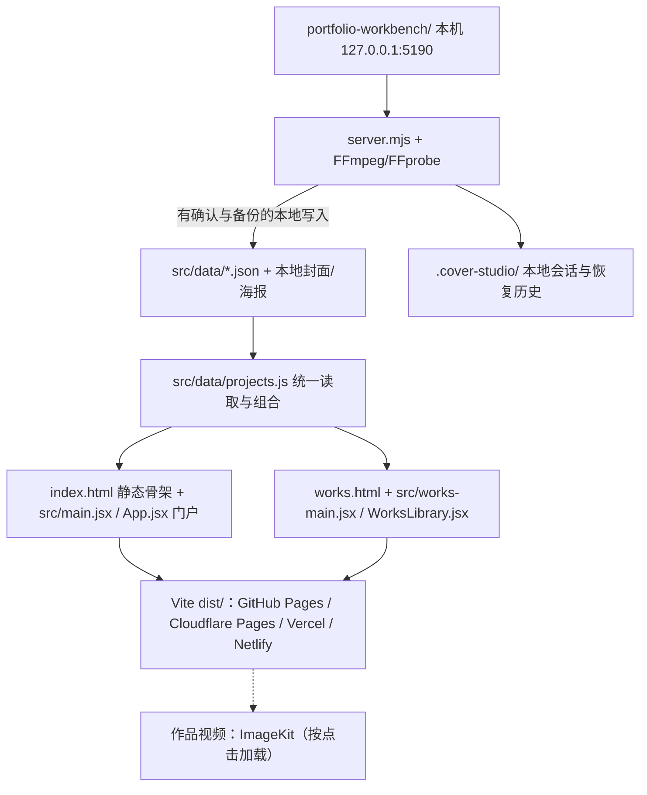

# 作品集工程架构 / Engineering Architecture

> 新工程师的第一站。核对基线：2026-11-17，本地 `chore/portfolio-docs-neat-20261117`。**这是代码职责地图，不是新的视觉规范或重构提案。** 代码行为以源码为准；站点视觉以 [设计规范](docs/设计规范.md) 为准，涉及写入与计费先看 [AGENTS.md](AGENTS.md)。

## 30 秒理解

本仓库有**两套不同运行环境**：可部署的静态作品集（Vite + React + 原生 HTML/视频）和**只在 Mac 本机运行**、可改写作品资料/封面的管理工作台（Node HTTP + Vite SSR 模块加载 + FFmpeg）。两者经由 `src/data/` 的 JSON 与本地 `assets/` 关联，**工作台的保存不等于线上发布**。

## 启动与入口

| 目标 | 命令或入口 | 谁负责 |
| --- | --- | --- |
| 首页开发 | `npm ci && npm run dev` → `http://127.0.0.1:5174/` | `index.html`（首屏骨架、内嵌 CSS/原生滚动与 Hero）+ `src/main.jsx`（React 启动）+ `src/App.jsx`（多个 Portal） |
| 全部作品 | `http://127.0.0.1:5174/works.html` | `works.html` → `src/works-main.jsx` → `src/components/WorksLibrary.jsx` |
| 本地工作台 | `npm run workbench` → `http://127.0.0.1:5190/` | `portfolio-workbench/server.mjs` 提供本机 API、媒体流与 FFmpeg；`app.js` + `library-ui.js` 控制工作台界面 |
| 生产构建 | `npm run build`，输出 `dist/` | `vite.config.js` 的双 HTML 入口、封面预加载与静态资源复制 |
| 快速回归 | `npm run check:project` | `scripts/run-check-suite.mjs` 与 `scripts/lib/check-suite-catalog.mjs` |
| 深度回归 | `npm run check:site-full` / `npm run check:workbench-full` | `scripts/run-adversarial-checks.mjs`；先确保媒体隔离 |

工作台依赖本机 FFmpeg/FFprobe，写入视频、封面和作品数据；**禁止在正式 `.cover-studio/` 上另起测试服务或清理历史**。本地上传目录可能因用户机器而不同：见 `portfolio-workbench/server.mjs` 的 `COVER_STUDIO_VIDEO_DIR`。

## 模块职责与修改落点

| 需求 | 先看这里 | 注意边界 |
| --- | --- | --- |
| 首页 Hero 播放、手机 C 循环、滚动 seek | `index.html` 的 `#hero-video` 初始化；`src/utils/heroImmersivePreview.js`；`src/styles/hero-journey.css` | 首页原生脚本与 React 并行；`portfolio:react-ready` 通知布局可重新定位，**不是所有功能都由 React 接管** |
| 首页精选 | `src/components/MagneticProjectArchive.jsx`、`ProjectCard.jsx`；`src/data/projects.js` | 当前精选名单以 `project-order.json.featured` 为准，不读取旧条目上的 `featured` 当成最终真值 |
| 作品库筛选和分享 | `src/components/WorksLibrary.jsx` | `?watch=ID` 开作品海报、不自动播；`?project=ID` 是工作台的定位高亮；返回历史需专项测试 |
| 作品播放器和目录 | `CinemaPlayer.jsx`、`CinemaWorkDirectory.jsx`、`MobilePlaybackControls.jsx`、`src/data/version-order.js` | `main` 是版本身份，不一定是首个显示版本；按点击才请求作品 MP4 |
| 荣誉、社交与 AI 实验室 | `ImpactEvidence.jsx`、`ExperimentFlip.jsx`、`ExternalLinkSheet.jsx` | React Portal、弹窗、焦点和浏览器历史相互作用 |
| 视觉与玻璃 | `src/styles/card-surfaces.css`、`apple-system.css`、`navigation.css` 及各组件 CSS；首页内嵌样式 | 遵循 [设计规范](docs/设计规范.md)；先搜索最终选择器及覆盖层，不批量删 `!important` |
| 新作品/版本、排序、归档 | `portfolio-workbench/server.mjs` 路由 → `project-publisher.mjs`、`project-versions.mjs`、`project-order.mjs`、`project-archive.mjs` | 工作台修改磁盘 JSON 和素材；有确认、历史和异常回滚，不直接上传 ImageKit/发布站点 |
| 封面、海报、更名 | `project-poster.mjs`、`project-titles.mjs`、`artwork-history.mjs` | 3:4 封面与原比例播放器海报独立保存；`.cover-studio/project-revisions/` 不可清理 |
| 数据模型与字段优先级 | `src/data/projects.js`、`src/data/version-order.js` | 先读 [作品数据字典](docs/作品数据字典.md)，再更改 JSON 或服务端写入路径 |

## 容易遗漏的跨层关系

1. **静态 HTML + Portal**：`src/App.jsx` 按 `projects-react-root`、`recognition-react-root` 等既有 DOM 节点挂载交互。删掉 HTML 占位节点可能导致 React 功能消失、首屏移位。不要在没有布局检查前把首页整体迁移进 React。
2. **浏览器历史不是一个人的职责**：`index.html` 控制首页导航与定位；`WorksLibrary.jsx` 处理作品 URL；`CinemaPlayer.jsx` 还监听 `popstate`。修改返回/关闭行为，必须一起回归。
3. **工作台依赖公开作品数据**：`server.mjs` 的 `projects()` 通过 Vite `ssrLoadModule('/src/data/projects.js')` 读取最终作品清单，而不是复制一份单独的数据库。改变数据导出契约也会影响工作台。
4. **开发与生产视频来源不同**：`projects.js` 在 Vite 开发模式取本地 `assets/videos/works/`，构建后走已登记的 ImageKit URL；视频路径、封面和海报分别维护。
5. **云端 Hero Range 兼容**：Cloudflare `*.pages.dev` 的桌面/手机 scrub 源按条件指向 GitHub Pages **同文件 hash** 的 MP4，以支持 HTTP 206；手机 C 自动循环仍来自当前网站。PR 单独更新 Hero hash 时，镜像在 main 部署前可能缺失，见 [交接说明](docs/交接说明.md)。
6. **部署有不同生产入口**：GitHub Actions `.github/workflows/deploy-pages.yml` 仅在 `main` 更新时发布 GitHub Pages；其他平台的 Git 自动部署与具体状态以平台检查记录为准。合并 `main` 会触发多个平台，不是一次无成本操作。

## 修改前的检查顺序

1. `git status --short --branch`，确认所在分支及本地未提交的数据；不覆盖正在使用的工作台历史。
2. 修改作品数据：先看 [数据字典](docs/作品数据字典.md)；修改播放器：先看 [播放器媒体维护](docs/播放器媒体维护.md)；改视觉：先看 [设计规范](docs/设计规范.md)。
3. `npm run build && npm run check:plan && git diff --check`，再选择对应模块专项；多模块改动执行 `npm run check:project`，上线前考虑深测。
4. 自动化浏览器在**导航前**使用 `scripts/lib/safe-media.mjs`，严禁真实加载 ImageKit/其他在线视频进行批量测试；Netlify 流量与 ImageKit 缩略图可能产生费用。
5. 本地 Commit → 单独 PR → 核对预览与 main 发布范围。没有明确发布意图就**不 push/merge**。

## 不该凭直觉清理的东西

- `.cover-studio/`、`assets/videos/works/`、本地历史和备份：有实际素材与恢复职责。
- `AI Short Flims`：拼写有误但历史路径已被多个模块使用；不可直接重命名。
- `hero-mobile-pingpong.mp4`：文件名历史遗留，当前内容是正向 C 光学溶接。
- 看似没被主入口引用的 WebGL / Hero 评审模块：只记入 [历史代码待清理清单](docs/历史代码待清理清单.md)，先核验所有入口和回归，再决定是否删除。

更多详情从 [项目文档索引](docs/文档索引.md) 按需求阅读，而不是从头阅读所有维护文件。
