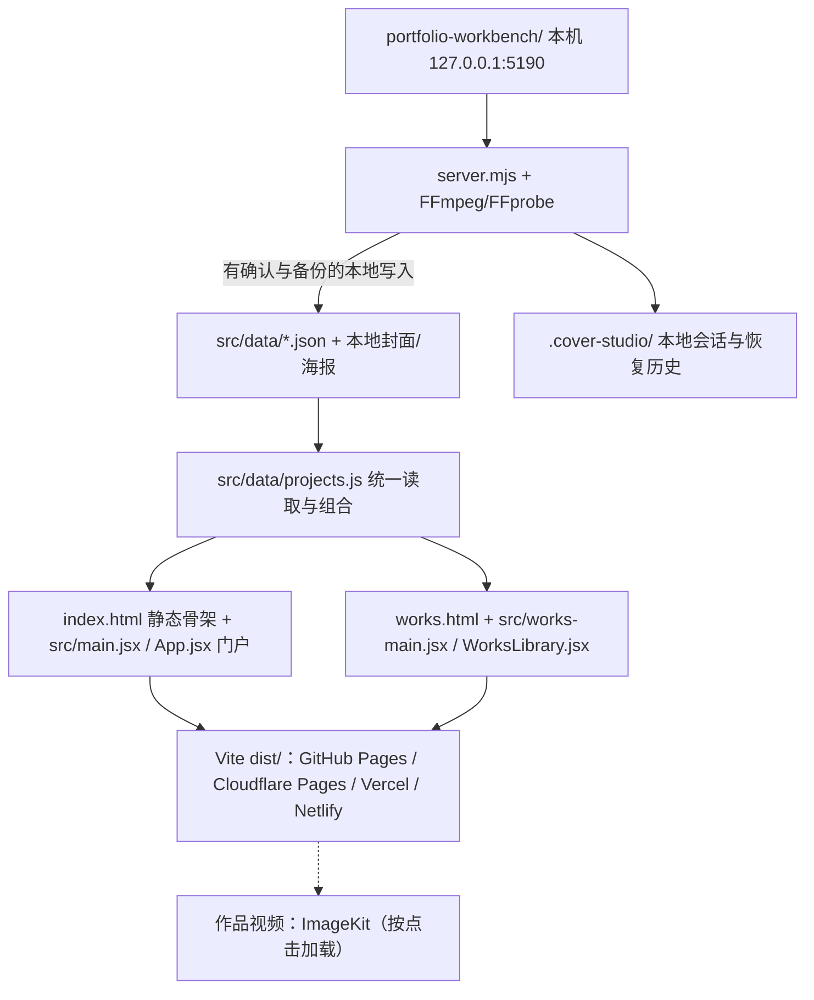

# 作品集工程架构 / Engineering Architecture

> 新工程师的第一站。核对基线：2026-11-17，本地 `chore/portfolio-docs-neat-20261117`。**这是代码职责地图，不是新的视觉规范或重构提案。** 代码行为以源码为准；站点视觉以 [设计规范](docs/设计规范.md) 为准，涉及写入与计费先看 [AGENTS.md](AGENTS.md)。

## 30 秒理解

本仓库有**两套不同运行环境**：可部署的静态作品集（Vite + React + 原生 HTML/视频）和**只在 Mac 本机运行**、可改写作品资料/封面的管理工作台（Node HTTP + Vite SSR 模块加载 + FFmpeg）。两者经由 `src/data/` 的 JSON 与本地 `assets/` 关联，**工作台的保存不等于线上发布**。



## 启动与入口

Node.js 运行版本：^20.19.0 或 >=22.12.0；Vite 相对资源路径支持 GitHub Pages 根路径与子路径。

| 目标 | 命令或入口 | 谁负责 |
| --- | --- | --- |
| 首页开发 | `npm ci && npm run dev` → `http://127.0.0.1:5174/` | `index.html`（首屏骨架、内嵌 CSS/原生滚动与 Hero）+ `src/main.jsx`（React 启动）+ `src/App.jsx`（多个 Portal） |
| 全部作品 | `http://127.0.0.1:5174/works.html` | `works.html` → `src/works-main.jsx` → `src/components/WorksLibrary.jsx` |
| 作品管理工作台 | `npm run workbench` → `http://127.0.0.1:5190/` | `portfolio-workbench/server.mjs` 提供本机 API、媒体流与 FFmpeg；`app.js` + `library-ui.js` 控制工作台界面 |
| 生产构建 | `npm run build`，输出 `dist/` | `vite.config.js` 的双 HTML 入口、封面预加载与静态资源复制 |
| 快速回归 | `npm run check:project` | `scripts/run-check-suite.mjs` 与 `scripts/lib/check-suite-catalog.mjs` |
| 深度回归 | `npm run check:site-full` / `npm run check:workbench-full` | `scripts/run-adversarial-checks.mjs`；先确保媒体隔离 |

工作台依赖本机 FFmpeg/FFprobe，写入视频、封面和作品数据；**禁止在正式 `.cover-studio/` 上另起测试服务或清理历史**。本地上传目录可能因用户机器而不同：见 `portfolio-workbench/server.mjs` 的 `COVER_STUDIO_VIDEO_DIR`。

## 模块职责与修改落点

| 需求 | 先看这里 | 注意边界 |
| --- | --- | --- |
| 首页 Hero 播放、手机 C 循环、滚动 seek | `index.html` 的 `#hero-video` 初始化；`src/utils/heroImmersivePreview.js`；`src/styles/hero-journey.css` | 首页原生脚本与 React 并行；`portfolio:react-ready` 通知布局可重新定位，**不是所有功能都由 React 接管** |
| 首页精选 | `src/components/MagneticProjectArchive.jsx`、`ProjectCard.jsx`；`src/data/projects.js` | 当前精选名单以 `project-order.json.featured` 为准，不读取旧条目上的 `featured` 当成最终真值 |
| 作品库筛选和分享 | `src/components/WorksLibrary.jsx` | `?watch=ID` 开作品海报、不自动播；`?project=ID` 是工作台的定位高亮；返回历史需专项测试 |
| 作品播放器和目录 | `CinemaPlayer.jsx`、`CinemaWorkDirectory.jsx`、`MobilePlaybackControls.jsx`、`src/data/version-order.js` | `main` 是版本身份，不一定是首个显示版本；按点击才请求作品 MP4 |
| 荣誉、社交与 AI 实验室 | `ImpactEvidence.jsx`、`ExperimentFlip.jsx`、`ExternalLinkSheet.jsx` | React Portal、弹窗、焦点和浏览器历史相互作用 |
| 视觉与玻璃 | `src/styles/card-surfaces.css`、`apple-system.css`、`navigation.css` 及各组件 CSS；首页内嵌样式 | 遵循 [设计规范](docs/设计规范.md)；先搜索最终选择器及覆盖层，不批量删 `!important` |
| 新作品/版本、排序、归档 | `portfolio-workbench/server.mjs` 路由 → `project-publisher.mjs`、`project-versions.mjs`、`project-order.mjs`、`project-archive.mjs` | 工作台修改磁盘 JSON 和素材；有确认、历史和异常回滚，不直接上传 ImageKit/发布站点 |
| 封面、海报、更名 | `project-poster.mjs`、`project-titles.mjs`、`artwork-history.mjs` | 3:4 封面与原比例播放器海报独立保存；`.cover-studio/project-revisions/` 不可清理 |
| 数据模型与字段优先级 | `src/data/projects.js`、`src/data/version-order.js` | 先读 [作品数据字典](docs/作品库维护.md#作品数据模型与读写契约)，再更改 JSON 或服务端写入路径 |

## 容易遗漏的跨层关系

1. **静态 HTML + Portal**：`src/App.jsx` 按 `projects-react-root`、`recognition-react-root` 等既有 DOM 节点挂载交互。删掉 HTML 占位节点可能导致 React 功能消失、首屏移位。不要在没有布局检查前把首页整体迁移进 React。
2. **浏览器历史不是一个人的职责**：`index.html` 控制首页导航与定位；`WorksLibrary.jsx` 处理作品 URL；`CinemaPlayer.jsx` 还监听 `popstate`。修改返回/关闭行为，必须一起回归。
3. **工作台依赖公开作品数据**：`server.mjs` 的 `projects()` 通过 Vite `ssrLoadModule('/src/data/projects.js')` 读取最终作品清单，而不是复制一份单独的数据库。改变数据导出契约也会影响工作台。
4. **开发与生产视频来源不同**：`projects.js` 在 Vite 开发模式取本地 `assets/videos/works/`，构建后走已登记的 ImageKit URL；视频路径、封面和海报分别维护。
5. **云端 Hero Range 兼容**：Cloudflare `*.pages.dev` 的桌面/手机 scrub 源按条件指向 GitHub Pages **同文件 hash** 的 MP4，以支持 HTTP 206；手机 C 自动循环仍来自当前网站。PR 单独更新 Hero hash 时，镜像在 main 部署前可能缺失，见 [交接说明](ARCHITECTURE.md)。
6. **部署有不同生产入口**：GitHub Actions `.github/workflows/deploy-pages.yml` 仅在 `main` 更新时发布 GitHub Pages；其他平台的 Git 自动部署与具体状态以平台检查记录为准。合并 `main` 会触发多个平台，不是一次无成本操作。

## 修改前的检查顺序

1. `git status --short --branch`，确认所在分支及本地未提交的数据；不覆盖正在使用的工作台历史。
2. 修改作品数据：先看 [数据字典](docs/作品库维护.md#作品数据模型与读写契约)；修改播放器：先看 [播放器媒体维护](docs/播放器媒体维护.md)；改视觉：先看 [设计规范](docs/设计规范.md)。
3. `npm run build && npm run check:plan && git diff --check`，再选择对应模块专项；多模块改动执行 `npm run check:project`，上线前考虑深测。
4. 自动化浏览器在**导航前**使用 `scripts/lib/safe-media.mjs`，严禁真实加载 ImageKit/其他在线视频进行批量测试；Netlify 流量与 ImageKit 缩略图可能产生费用。
5. 本地 Commit → 单独 PR → 核对预览与 main 发布范围。没有明确发布意图就**不 push/merge**。

## 不该凭直觉清理的东西

- `.cover-studio/`、`assets/videos/works/`、本地历史和备份：有实际素材与恢复职责。
- `AI Short Flims`：拼写有误但历史路径已被多个模块使用；不可直接重命名。
- `hero-mobile-pingpong.mp4`：文件名历史遗留，当前内容是正向 C 光学溶接。
- 看似没被主入口引用的 WebGL / Hero 评审模块：只记入 [历史代码待清理清单](docs/历史代码待清理清单.md)，先核验所有入口和回归，再决定是否删除。

后续维护使用本文文末的职责导航，不必逐份阅读历史文档。


## 发布部署与 Cloudflare Range 兼容

仓库中 `.github/workflows/deploy-pages.yml` 只在 `main` 分支推送或手动触发时构建并发布 GitHub Pages；`netlify.toml` 声明 `npm run build` 和 `dist`。Cloudflare Pages、Vercel、Netlify 曾通过 Git 集成生成 PR 预览；连接及计费状态可能变化，判断是否已部署当前提交，应以各平台的实时部署记录为准。

已知访问地址：

正式主域名为 `https://ailuren.netlify.app/`，首页与作品库的 canonical、分享地址及首页结构化数据使用该域名；其余平台保留为访问入口。

- GitHub Pages：<https://ai-luren.github.io/>
- Cloudflare Pages：<https://ailuren.pages.dev/>
- Vercel：<https://ailuren.vercel.app/>
- Netlify：<https://ailuren.netlify.app/>

地址可访问不代表它们都已部署最新提交；发布状态以平台的部署记录为准。正式对外仍保留 Netlify canonical，不把临时 Preview 或其他镜像写进 canonical。Netlify 免费额度耗尽时可能返回 `usage_exceeded / HTTP 503`；不要自动刷站复现，查看账单及下个结算周期后再判断是否恢复。

### Cloudflare Pages 的桌面 Hero 兼容

Cloudflare Pages 静态 MP4 对 HTTP Range 请求返回 `200`，桌面滚动驱动视频无法可靠跳帧。当前 `index.html` 仅在 `*.pages.dev` 域名下，将 **桌面** `hero-<hash>.mp4` 的视频源切换至 `https://ai-luren.github.io/assets/hero-<hash>.mp4`；后者支持 `206 Partial Content`。手机 C 版 `hero-mobile-pingpong` 仍直接在 Cloudflare 正向循环；手机 `?heroMode=scrub` 与自动播放失败回退也使用支持 Range 的原片镜像。Netlify、Vercel 与 GitHub Pages 的原有视频引用不改变。

**发布顺序约束：** GitHub Pages 只从 `main` 构建。若 PR 单独修改 Hero 视频，新的 Vite 文件 hash 尚未在 GitHub Pages 发布，Cloudflare 分支 Preview 的桌面视频镜像可能暂时 404；不要把它误诊为新脚本故障。需要同时更新 Hero 时，先安排镜像资源发布与校验，或在本地用媒体替身测试；绝不通过反复在线加载 MP4 探测。当前补丁的域名条件只覆盖 `*.pages.dev`，将来自定义 Cloudflare 域名前要单独复核。

**计费保护：** 在线站点不是免费的自动化测试靶场。Netlify 流量会消耗 Credits，ImageKit 的后台媒体列表/缩略图还可能消耗 VPU。批量测试、截图和性能比较应使用本地 Vite/构建预览，并在浏览器导航前拦截全部第三方媒体；真正需要验证线上单条视频时，先征得明确批准并限制请求次数。详见 [测试与回归维护](docs/测试与回归维护.md)。

## 公开站运行时细节

- `index.html` 是首页，包含页面章节、Hero 背景视频、全局样式、静态文案和滚动叙事。
- `src/main.jsx` 先挂载 React（Hero 标题已有 HTML 静态兜底），GSAP 和滚动增强异步初始化，不得阻塞精选、文字或章节导航。
- `src/App.jsx` 将交互组件挂到首页预留节点：
  - `#projects-react-root` → `MagneticProjectArchive`，读取共享作品数据中的 8 件精选作品。
  - `CinemaPlayer` → 首页影院播放器，按当前精选顺序切换作品。
  - `#recognition-react-root` → `ImpactEvidence`，包含 8 张获奖图片网格与查看器、AI 平台展示和自媒体账号资料弹窗。自媒体使用单色平台标识，AI 平台展示使用彩色品牌标识。
  - `#footer-dock-react-root` → `FloatingDock`，提供复制操作、社交入口及粗指针下的 `ExternalLinkSheet` 确认。
  - `#experiments-react-root` → `ExperimentFlip` 三个站内项目详情，真实示例图片放在 `assets/images/lab/`，具体素材/外链/回归说明见 [AI 实验室与外链维护](docs/AI实验室与外链维护.md)；另有 `#hero-actions-react-root`、`#hero-title-react-root` 的 Hero 交互。
  - 当前正式 Hero 只用原生视频加静态首帧；旧 `VideoPostProcess` / WebGL 后处理不挂载到 App。
- `works.html` 是独立的第二个 Vite 构建入口；`src/works-main.jsx` 挂载 `WorksLibrary`，按当前筛选结果切换作品并共用影院播放器。 分享链接 `?watch=ID` 会预先打开对应作品的静态海报但不自动播放，工作台 `?project=ID` 只用于高亮定位；播放器的浏览器 Back/Forward 状态由 `WorksLibrary` 管理。
- 首页和作品库保持独立 HTML 入口，`pagePrefetch.js` 仅预热另一页面的 HTML/JS/CSS 而不预取作品 MP4；原生 View Transition 在两页之间使用约 300ms 无模糊的透明度交接，取消旧 660ms 模糊和虚假百分比进度条。浏览器不支持时照常导航。Hero 的滚动提示与 2px 阅读进度线保留；浏览器 Back/Forward 和深链锚点尊重原生恢复与用户输入，回归 `check:page-handoff` / `check:cross-page-nav`。
- 作品库首排图片由 `vite.config.js` 根据作品顺序及分类生成 HTML 预加载候选，并按断点只激活真正首排；React 的首两排会立即挂载图片，其余进入 1100px 观察器预取距离后才设置 `src` 并转为 `loading="eager"`，避免原生 lazy 和 JS 延后加载叠加。分类按钮在指针或焦点意图时预热首排，工作台更换封面后需要重新构建。回归 `npm run check:image-loading`。
- 首页精选固定八件：手机 2×4 完整展示，桌面四列；首行在 React 挂载时即请求封面，其他卡片由 1100px 观察器决定挂载，接近视口时立即 eager 解码，避免黑色空卡。获奖八张缩略图也提前预热，作品 MP4 仍必须用户主动点击播放才请求，影院先解码静态海报。三个电影穿行间隔由 `index.html` 初始解析提供，`heroImmersivePreview.js` 只复用；三个 React 门户的 `:empty` 临时高度为初次深链保留空间，禁止挂载后才插入大段占位。
- `src/data/projects.js` 汇总原有作品和工作台的 `auto-projects.json`；`project-order.json` 的 `featured` 控制固定八件精选名单，`all` 独立控制完整库顺序，手机八件同屏页面自然滚动，不再有四件一页的旧分页。作品内 A/B/C 顺序见 `project-version-order.json`；归档和媒体元数据分别见 `archive-state.json`、`project-video-metadata.json`。
- `src/styles/navigation.css` 提供作品库、影院和奖项查看器共用的导航规则；作品库普通页左侧为 A+ 圆形箭头 +「首页 / Home」，指向 `./index.html#top` Hero 首屏，桌面中央的「精选作品 / Featured」另跳 `#projects`；详情查看器仍使用创作者头像。基础视觉 Token 在 `src/styles/card-surfaces.css` 与 `src/styles/apple-system.css`。

## 媒体路径、工作台安全与首帧

- 桌面 Hero：`assets/videos/hero/hero.mp4`。
- 手机 Hero（≤760px）：默认 `assets/videos/hero/hero-mobile-pingpong.mp4`（约 13.83s / 24fps / 480×1040，已选 C「光学溶接」：前向播放，在首尾约 1.21s 交叉融合成单条 MP4，约 2.77MB；历史文件名保留用于兼容），`?heroMode=scrub` 或静音自动播放被拒绝则使用原 `hero-mobile.mp4`（约 15.04s / 24fps / 480×1040）按滚动进度定位；桌面保持 `hero.mp4` 滚动定位。
- 作品列表 3:4 封面：`assets/images/project-covers/<category>/<English Title>.webp`，按四分类英文目录存放；替换前备份旧图。
- 原比例播放器海报：`assets/images/player-posters/<category>/<MP4 English Stem>.webp`；实际显示宽高与海报映射见 `src/data/project-video-metadata.json`。
- 原有作品主版本的 ImageKit `tr:orig-true` 地址位于 `src/data/legacy-imagekit-urls.json`，旧作品新增版本位于 `legacy-video-variants.json`，工作台新增作品（目前 ID 16–20）的主视频与扩展版本位于 `auto-projects.json`；本地 Vite 从 `assets/videos/works/` 读取原片，不请求 ImageKit；正式构建不会复制本地作品原片。
- `assets/videos/works/` 保存与当前作品及版本映射对应的本地 MP4，文件名按英文作品标题维护，已由 `.gitignore` 排除，供本地开发播放，不进正式构建。上传源片目录与项目视频目录分离；不可把本地路径当线上 URL，也不要全局忽略 `*.mp4`（Hero 视频要参与构建）。
- 项目根目录 `portfolio-workbench/`（原来的双层 tools 目录已取消）是独立的作品管理工作台，通过 `npm run workbench` 启动在 `127.0.0.1:5190`，不参与 Vite 正式构建。修改工作台源码后先确认草稿已保存，再正常重启旧服务并执行 `npm run check:workbench-live`（真实浏览器、零 ImageKit 请求）；**不得为跑隔离测试而启动第二个服务指向正式工作目录**，服务初始化可能整理超限历史；导入、导出和历史保存在 Git 忽略的 `.cover-studio/`；`archive-state.json` 可恢复归档整部作品或单个视频（含 `main`），不删除媒体文件。重新部署才会影响公开列表。
- 页面使用系统字体栈；`vendor/` 保留 GSAP 与 ScrollTrigger 静态脚本。

## 本地生产预览与截图取证

使用 `scripts/capture-final-review.mjs` 对正式构建的本地预览取证，不能只验证开发模式：Vite 提取共享 CSS 后的顺序可能不同。先运行 `npm run build`，再运行 `npm run preview -- --host 127.0.0.1 --port 5182 --strictPort`，另一个终端执行：

```bash
PORTFOLIO_URL=http://127.0.0.1:5182/ \
REVIEW_SCREENSHOTS="$(dirname "$PWD")/final-review-screenshots" \
node scripts/capture-final-review.mjs
```

输出目录必须在仓库外。脚本等待 React、字体、逐屏滚动与动画、普通图片和 CSS 背景图解码，并输出中文/英文桌面与手机全页及局部截图、播放器与荣誉查看器截图和 `browser-verification.json`（HTTP、Console、解码、DOM 与 Hero 状态）。全页截图中的固定视频背景只代表截图当时的一帧；滚动叙事请结合 Hero 和章节局部视口截图判断。脚本不点击播放，并阻断且断言没有 ImageKit 视频请求。

## 按职责阅读维护文档

| 任务 | 唯一负责人 |
| --- | --- |
| 视觉系统、玻璃、导航与响应式 | [视觉系统、玻璃、导航与响应式](docs/设计规范.md) |
| 作品 JSON、标题、排序与归档 | [作品 JSON、标题、排序与归档](docs/作品库维护.md) |
| Hero、影院、版本与海报 | [Hero、影院、版本与海报](docs/播放器媒体维护.md) |
| 作品管理工作台用户操作 | [作品管理工作台用户操作](docs/作品管理工作台使用指南.md) |
| 作品管理工作台 API 与写入安全 | [作品管理工作台 API 与写入安全](docs/作品管理工作台技术维护.md) |
| 测试、媒体计费与安全缓存 | [测试、媒体计费与安全缓存](docs/测试与回归维护.md) |
| AI 实验室与站外链接 | [AI 实验室与站外链接](docs/AI实验室与外链维护.md) |
| 历史代码核验候选 | [历史代码核验候选](docs/历史代码待清理清单.md) |

历史审计与过期方案只存于本地 Git 忽略的 .audit/，其中 docs-history/ 是只读快照；不作为当前页面或工作台规格，也不是新克隆工程的运行依赖。
