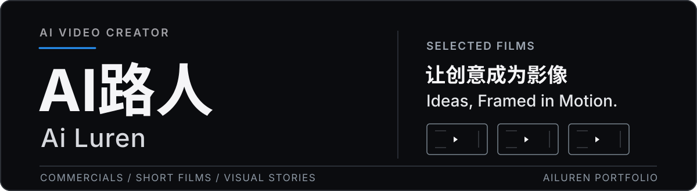

  

<h1 align="center">AI路人 · Ai Luren</h1>

  聚焦 AI 商业广告、创意影像与视觉叙事。 
  Commercial films, creative shorts and visual storytelling with AI.

  <a href="https://ailuren.netlify.app/"><strong>观看作品集 / View Portfolio</strong></a>
  &nbsp; · &nbsp;
  <a href="https://ailuren.netlify.app/works.html">按类型浏览 / Explore Films</a>
  &nbsp; · &nbsp;
  <a href="https://ailuren.netlify.app/#profile">合作联系 / Contact</a>

8 部首页精选　/　18 部作品 · 21 条本地视频　/　中英双语

> 作品数量和图片以本地项目为准；线上页面是否包含这些更新，应以实际部署版本为准。

---

## 01 / 精选影像 · Selected Films

四件作品，四种影像表达：从品牌广告到视觉实验。展示顺序不代表网站首页的精选顺序。

  
  

01 / MEXC 会员权益（A+B）　　　02 / 最难的告别

  
  

03 / 屈臣氏 AI 品牌广告　　　04 / 联想 AI 品牌广告

**作品说明**：《MEXC 会员权益》是 MEXC 相关创意测试作品，并非官方委托商业广告；同一张作品卡可在播放器内切换 A / B 版本。

**[进入在线精选作品 / Explore Selected Work](https://ailuren.netlify.app/#projects)**

## 02 / 创作方向 · Creative Fields

- **AI 商业广告 / Commercials · 9**：品牌形象、TVC、产品推广与文旅宣传。
- **AI 创意短片 / Short Films · 3**：故事、人物、情绪与概念影像。
- **AI 海外产品广告 / Product & Social Ads · 4**：产品展示、生活场景与社媒短视频。
- **AI 视觉实验 / Visual Experiments · 2**：风格探索、视觉特效与实验短片。

作品库以 **3:4 竖版封面**呈现，播放时保留影片原始比例。桌面端、手机端均支持分类切换与中英文浏览；首页 8 部精选可以独立调整，不必与全部作品顺序一致。

## 03 / 荣誉与展映 · Recognition

作品集记录 **8 项获奖、入围或公开展映**，分别标注其真实性质，包括：

- **Midjourney 官方优秀作品**、美图未来 AI 设计大赛年度入围、联想 AI 比赛创作先锋奖。
- **海螺 AI 动物跳水 LED 大屏展映**、可灵无限剧场小赛超棒奖。
- **中国联通「海纳星火计划」**两件独立创作的三等奖，以及 Pollo.ai 影视级特效小赛优秀奖。

[查看荣誉与证明 / View Recognition](https://ailuren.netlify.app/#impact-awards) · 不将展映、转发或入围写作获奖。

## 04 / 更多创作 · Beyond Video

除了影片，作品集还展示 AI 创作者项目、自媒体实践与三个实际开发的 AI 工具：

- **AI 新闻追踪**：[Ainews-to-Feishu](https://github.com/Ai-luren/Ainews-to-Feishu)
- **AI 文章配图**：[Ailuren-illustrations](https://github.com/Ai-luren/Ailuren-illustrations)
- **图片对比**：[在线体验](https://ai-luren.github.io/Image-comparison/) · [GitHub](https://github.com/Ai-luren/Image-comparison)

## 05 / 网站与技术 · About This Portfolio

这是一个独立的个人作品集网站，而不是 AI 视频生成服务。它使用 **Vite · React · GSAP / ScrollTrigger · OGL / WebGL · ImageKit** 构建，围绕观看影片设计：

- **影院式浏览**：站内播放、上一部 / 下一部、原比例视频、同一作品的多版本切换。
- **统一交互体验**：首页、作品库、荣誉与资料弹窗共用导航和视觉规范，兼容电脑与手机。
- **按需获取作品视频**：影片只在访客主动点击播放后请求；首页滚动叙事的 Hero MP4 则会自动预热。开发模式使用本地作品 MP4，自动化测试拦截真实 ImageKit 流量。
- **本地作品工作台**：在桌面浏览器管理作品、视频版本、封面、播放器海报、精选排序，以及可恢复的作品／版本回收站；更详细的操作见[使用教程](./docs/本地封面工作台使用教程.md)。

<strong>本地运行 / Run Locally</strong>

需要 Node.js ^20.19.0 或 >=22.12.0。

~~~bash
npm ci
npm run dev
~~~

首页：<http://127.0.0.1:5174/>　·　作品库：<http://127.0.0.1:5174/works.html>

打开本地封面及作品管理工作台：

~~~bash
npm run covers
~~~

工作台：<http://127.0.0.1:5190/>

**媒体边界：** 本地作品 MP4 位于 Git 忽略的 assets/videos/works/，不会随仓库克隆，也不会进入生产构建。开发模式缺少原片时不会自动转向 ImageKit；正式发布使用作品数据中配置的云端视频地址。运行工作台需安装 FFmpeg / FFprobe。 多次编辑的同内容临时视频会在本机使用只读共享存储，查看与验证命令见 [工作台使用教程](./docs/本地封面工作台使用教程.md#本地空间维护可选)。

<strong>项目结构、测试与维护 / Developer Notes</strong>

~~~text
index.html · works.html           首页与作品库入口
src/components/                  作品卡片、播放器与交互组件
src/data/projects.js             原有作品与作品数据汇总
src/data/auto-projects.json      新增作品及视频 A/B 版本
src/data/legacy-video-variants.json 旧作品追加的视频版本
src/data/project-order.json      首页精选与完整作品独立排序
assets/images/project-covers/    四分类下的 3:4 视频封面，文件名与英文作品名一致
assets/images/player-posters/    同分类、同英文文件名的原比例播放器海报
tools/cover-studio/              仅供本地使用的作品管理工作台
docs/                            设计规范与维护说明
~~~

~~~bash
npm run check:smoke          # 构建、素材、精选顺序和媒体安全
npm run check:home-scroll    # 先 build；弱网首页滚动与浏览器返回恢复
npm run check:workbench-core # 工作台核心流程、存储和视觉回归
npm run check:project        # 依次运行上述两组快速检查
npm run check:site-full      # 独立生产预览下逐项检查公开网页
npm run check:workbench-full # 隔离项目逐项检查工作台
npm run check:adversarial    # 网站和工作台全量深测，记录到本地 .audit
npm run check:i18n           # 需要时额外检查中英文
~~~

[文档索引](./docs/文档索引.md) · [设计规范](./docs/设计规范.md) · [工作台使用教程](./docs/本地封面工作台使用教程.md) · [开发约定](./AGENTS.md)

---

  <a href="https://ailuren.netlify.app/"><strong>观看作品 / Watch Films</strong></a>
  &nbsp; · &nbsp;
  <a href="https://ailuren.netlify.app/#profile">合作联系 / Contact</a>
  &nbsp; · &nbsp;
  <a href="./LICENSE">MIT License</a>

© 2026 AI路人 · Ai Luren · AI Video Creator

