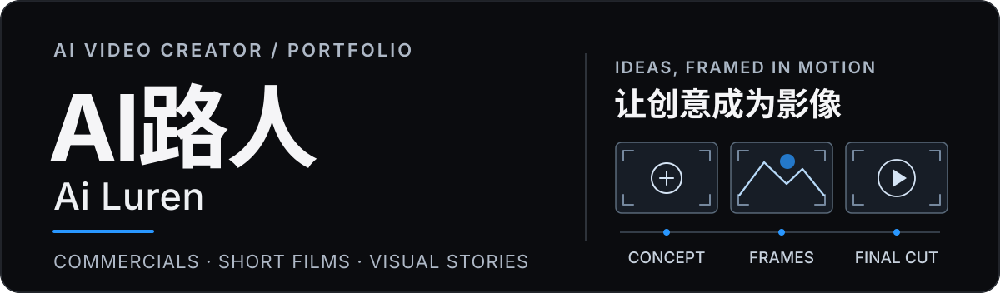

<p align="center">
  
</p>

<p align="center">
  用 AI 影像探索品牌表达、镜头语言与情绪叙事。<br>
  AI-assisted commercials, creative shorts and cinematic visual storytelling.
</p>

<p align="center">
  <a href="https://ailuren.netlify.app/"><strong>观看作品集 / Watch Films</strong></a>
  &nbsp; · &nbsp;
  <a href="https://ailuren.netlify.app/works.html">全部作品 / All Work</a>
  &nbsp; · &nbsp;
  <a href="https://ailuren.netlify.app/#profile">合作联系 / Contact</a>
</p>

<p align="center"><sub>
  备用访问 / Alternate access:
  <a href="https://ai-luren.github.io/">GitHub Pages</a>
  &nbsp;·&nbsp;
  <a href="https://ailuren.pages.dev/">Cloudflare Pages</a>
</sub></p>

---

## 精选影像 / Selected Films

四部来自当前精选名单的真实影像封面。点击进入网站可观看完整影片、原始画幅与不同创意版本。

Four works from the current featured collection. Watch the films and alternate cuts on the [portfolio website](https://ailuren.netlify.app/#projects).

<p align="center">
  
  
</p>
<p align="center"><sub>FORMFUNK · Creative Commercial Demo &nbsp; / &nbsp; THE KENNEL BETWEEN US · AI Narrative</sub></p>

<p align="center">
  
  
</p>
<p align="center"><sub>MEXC · No More Waiting Demo &nbsp; / &nbsp; THE HARDEST GOODBYE · AI Short Film</sub></p>

<p align="center"><a href="https://ailuren.netlify.app/#projects"><strong>浏览精选影像 / Explore Selected Films</strong></a></p>

<sub>作品说明：FormFunk 与 MEXC 为独立创意测试 / Demo，不代表品牌正式委托或官方发布。项目更新可能早于网站生产部署。</sub>

## 创作方向 / Creative Practice

- **品牌与商业影像 / Commercial Films** — AI TVC、品牌创意与文旅宣传片。
- **创意短片 / Creative Shorts** — 人物、情绪、故事与概念叙事。
- **产品与社媒影像 / Product & Social Films** — 产品表达、海外生活场景及多画幅内容。
- **视觉实验 / Visual Experiments** — 影像风格、镜头语言与视觉特效探索。

作品集支持分类浏览、中英双语、原始视频画幅与同一作品的多版本切换。

## 荣誉与展映 / Recognition

收录获奖、入围与公开展映记录，包括 Midjourney 官方优秀作品、美图未来 AI 设计大赛年度入围、联想 AI 创作先锋奖、海螺 AI LED 大屏展映，以及可灵、中国联通和 Pollo.ai 相关创作活动。各种记录按实际性质分别标注。

[查看荣誉与证明 / View Recognition](https://ailuren.netlify.app/#impact-awards)

## 影像之外 / Creative Tools

围绕日常 AI 影像创作与内容工作流开发的小工具：

- [Ainews-to-Feishu](https://github.com/Ai-luren/Ainews-to-Feishu) — AI 资讯整理及飞书同步。
- [Ailuren-illustrations](https://github.com/Ai-luren/Ailuren-illustrations) — 文章配图工具。
- [Image Comparison](https://github.com/Ai-luren/Image-comparison) — [在线图像对比](https://ai-luren.github.io/Image-comparison/)。

## 关于网站 / Behind the Portfolio

这是**个人 AI 视频作品集**，不是在线 AI 视频生成工具。前端基于 Vite、React、Motion 和 GSAP / ScrollTrigger；背景影像采用浏览器原生视频（桌面滚动驱动、手机 C 版正向光学溶接循环），当前公开版不启用旧 WebGL 后处理。

- **电影化浏览 / Cinematic Viewing**：八件精选影像、按分类浏览的完整作品库、原始比例播放器、同一作品 A/B/C 创意版本、双语导航与作品目录。D+ 玻璃根据阅读密度调整透景强度。
- **本地作品工作台 / Local Studio**：管理视频版本、作品排序、3:4 封面与原比例播放器海报；仅在本机运行，不随网站部署。
- **媒体边界**：作品原片 MP4 不随 Git 提交（Hero 背景 MP4 例外）。本地开发使用本地原片，公开播放器按用户点击才请求 ImageKit。没有原片的克隆环境无法完整验证作品视频播放。

<details>
<summary><strong>本地运行 / Run Locally</strong></summary>

Node.js `^20.19.0` 或 `>=22.12.0`：

```bash
npm ci
npm run dev
```

网站：首页 <http://127.0.0.1:5174/> · 作品库 <http://127.0.0.1:5174/works.html>

本地作品工作台（需要 FFmpeg / FFprobe）：

```bash
npm run workbench
```

工作台：<http://127.0.0.1:5190/>。更改工作台服务代码后需重启；`npm run covers` 是兼容别名。

</details>

<details>
<summary><strong>项目结构与测试 / Structure & Checks</strong></summary>

```text
index.html · works.html      首页与完整作品库
src/                         React 组件、国际化与作品数据
assets/                      封面、海报与网站素材
portfolio-workbench/         本地作品工作台（不部署）
scripts/checks/              网站及工作台回归测试
docs/                        设计规范与维护指南
```

```bash
npm run build                   # 生产构建
npm run check:plan              # 只读查看测试覆盖与重复检查
npm run check:smoke             # 基础构建、目录与媒体安全
npm run check:project           # 网站与工作台核心回归（非全部深测）
npm run check:cinema-controls   # 手机播放器交互
npm run check:cinema-local      # 本地视频缓冲与防黑屏
npm run check:cinema-version-motion # A/B 版本切换动画
npm run check:workbench-core    # 工作台核心回归
npm run check:i18n              # 中英文界面
```

开发者接手：[工程架构](./ARCHITECTURE.md) · [作品数据字典](./docs/作品数据字典.md) · [历史代码待清理清单](./docs/历史代码待清理清单.md)。

维护文档：[文档索引](./docs/文档索引.md) · [设计规范](./docs/设计规范.md) · [测试与回归](./docs/测试与回归维护.md) · [作品库维护](./docs/作品库维护.md) · [工作台教程](./docs/本地封面工作台使用教程.md) · [AGENTS](./AGENTS.md)。

</details>

---

<p align="center">
  <a href="https://ailuren.netlify.app/"><strong>完整作品集 / Full Portfolio</strong></a>
  &nbsp; · &nbsp;
  <a href="https://ailuren.netlify.app/#profile">联系合作 / Contact</a>
  &nbsp; · &nbsp;
  <a href="./LICENSE">MIT License</a>
</p>

<p align="center"><sub>AI路人 · Ai Luren · AI Video Creator · <a href="https://ai-luren.github.io/">备用镜像 / Backup site</a></sub></p>
