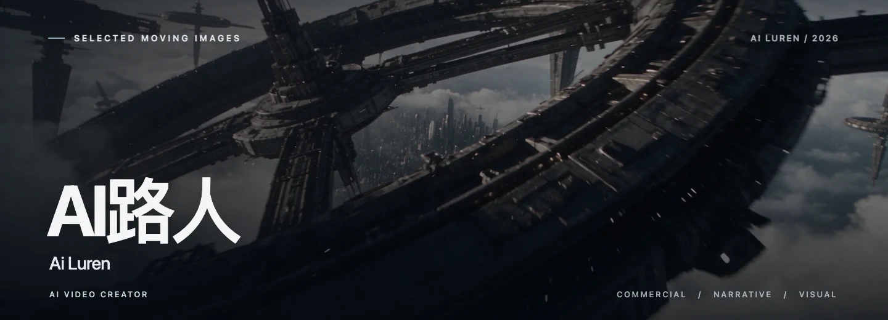

<p align="center">
  
</p>

<p align="center">
  <strong>以镜头讲述创意，以影像建立情绪。</strong><br>
  AI-assisted commercials, creative films & visual storytelling.
</p>

<p align="center">
  <a href="https://ailuren.netlify.app/"><strong>进入作品集 / Enter Portfolio</strong></a>
  &nbsp;&nbsp;·&nbsp;&nbsp;
  <a href="https://ai-luren.github.io/">GitHub Pages 镜像 / Mirror</a>
  &nbsp;&nbsp;·&nbsp;&nbsp;
  <a href="https://ailuren.netlify.app/#profile">合作联系 / Contact</a>
</p>

---

## 01 / 精选影像 · Selected Films

<sub>**EIGHT SELECTED WORKS** &nbsp;—&nbsp; AI COMMERCIALS / NARRATIVE / PRODUCT / VISUALS</sub>

<p align="center">
  <a href="https://ai-luren.github.io/works.html?watch=19"></a>
  <a href="https://ai-luren.github.io/works.html?watch=20"></a>
  <a href="https://ai-luren.github.io/works.html?watch=17"></a>
  <a href="https://ai-luren.github.io/works.html?watch=15"></a>
</p>

<p align="center">
  <a href="https://ai-luren.github.io/works.html?watch=01"></a>
  <a href="https://ai-luren.github.io/works.html?watch=16"></a>
  <a href="https://ai-luren.github.io/works.html?watch=18"></a>
  <a href="https://ai-luren.github.io/works.html?watch=02"></a>
</p>

<p align="center"><sub>01—08 / 点击封面进入对应影片 · Click a cover to explore the film</sub></p>

<p align="center"><a href="https://ailuren.netlify.app/works.html"><strong>浏览全部作品 / Explore All Work</strong></a></p>

<sub>部分作品为自主制作的创意测试（包括 FormFunk、MEXC Demo），不代表品牌正式委托或官方发布。封面对应真实项目，完整影片及 A/B 版本请以作品集页面为准。</sub>

## 02 / 创作方向 · Creative Practice

**Commercial Films** &nbsp; 品牌广告、产品 TVC 与文旅影像
**Narrative Films** &nbsp; AI 漫剧、人物故事与情绪叙事
**Product & Social** &nbsp; 海外产品广告、场景短片与多画幅内容
**Visual Studies** &nbsp; 镜头语言、视觉风格与创意特效实验

从视觉构思、AI 画面生成到最终成片，关注镜头、节奏、人物一致性与电影感表达。

## 03 / 荣誉与展映 · Recognition

作品曾获创作赛事与平台展示机会，包括 Midjourney 官方优秀作品、美图未来 AI 设计大赛年度入围、联想 AI 创作先锋奖与海螺 AI LED 大屏展映等。获奖、入围与平台展示分别标注，不混为同类荣誉。

[查看荣誉与证明 / View Recognition](https://ailuren.netlify.app/#impact-awards)

## 04 / 影像之外 · Creative Tools

日常创作中开发的小工具与开源项目：

[Ainews-to-Feishu](https://github.com/Ai-luren/Ainews-to-Feishu) · AI 资讯整理与飞书同步
[Ailuren-illustrations](https://github.com/Ai-luren/Ailuren-illustrations) · 文章配图工具
[Image Comparison](https://github.com/Ai-luren/Image-comparison) · [在线图片对比](https://ai-luren.github.io/Image-comparison/)

<details>
<summary><strong>关于这个网站 / Behind the Portfolio</strong></summary>

<br>

这是个人 AI 视频作品集，不是在线 AI 视频生成工具。使用 Vite、React、Motion 和 GSAP / ScrollTrigger，呈现原始比例影像、双语界面、多版本播放器与滚动驱动的电影化浏览。

- **桌面 Hero**：原生视频按滚动位置驱动；手机使用 C 版正向光学溶接循环。
- **作品管理工作台**：`portfolio-workbench/` 在本机管理作品顺序、版本、3:4 封面与各版原比例海报，不随网站部署。
- **媒体边界**：作品原片不进入公开 Git 仓库（Hero 背景例外）；公开播放器仅在主动播放后请求 ImageKit。没有本地原片的克隆环境不能完整验证视频播放。

### 本地运行 / Run Locally

Node.js `^20.19.0` 或 `>=22.12.0`：

```bash
npm ci
npm run dev
```

首页：<http://127.0.0.1:5174/> · 作品库：<http://127.0.0.1:5174/works.html>

作品管理工作台需要 FFmpeg / FFprobe，运行 `npm run workbench`，打开 <http://127.0.0.1:5190/>。

### 构建与验证 / Build & Checks

```bash
npm run build
npm run check:plan
npm run check:project
```

`check:project` 是网站与工作台核心快速回归，**不等同于全量深度测试**。更多入口见 [测试与回归维护](./docs/测试与回归维护.md)。

工程交接：[ARCHITECTURE](./ARCHITECTURE.md) · [设计规范](./docs/设计规范.md) · [作品库维护](./docs/作品库维护.md) · [工作台使用指南](./docs/作品管理工作台使用指南.md) · [AGENTS](./AGENTS.md)。

</details>

---

<p align="center">
  <a href="https://ailuren.netlify.app/"><strong>WATCH THE FILMS</strong></a>
  &nbsp;&nbsp; · &nbsp;&nbsp;
  <a href="https://ailuren.netlify.app/#profile">LET'S COLLABORATE</a>
  &nbsp;&nbsp; · &nbsp;&nbsp;
  <a href="./LICENSE">MIT LICENSE</a>
</p>

<p align="center"><sub>AI路人 / Ai Luren &nbsp; · &nbsp; AI Video Creator</sub></p>
