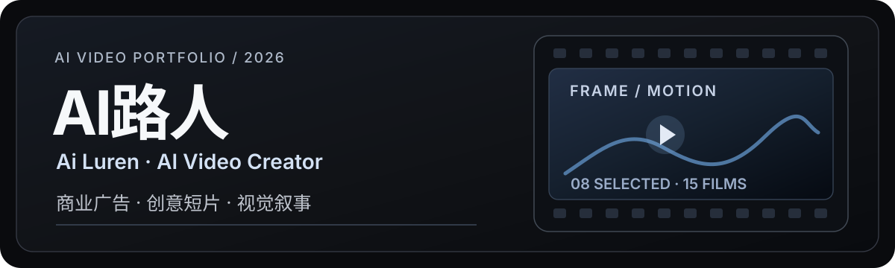

# Ai路人｜AI 视频创意与影像效果作品集

<p align="center">
  
</p>

为品牌创作 AI 广告、产品影像与创意短片，从创意构思到最终成片。网站支持中文与英文浏览，可从首页查看精选作品，也可进入完整作品库。

<p align="center">
  <a href="https://ailuren.netlify.app/">在线作品集</a> ·
  <a href="https://ailuren.netlify.app/works.html">全部作品</a> ·
  <a href="#本地运行">本地运行</a> ·
  <a href="./docs/交接说明.md">维护说明</a>
</p>

## 代表作品

首页精选 8 件创作，完整作品库共 15 件，涵盖商业广告、创意短片、社媒与 UGC、视觉实验。以下为首页精选中的真实项目封面；打开在线作品集可在站内播放器查看作品。

<p align="center">
  
  
</p>
<p align="center"><sub>通义万相 AI 品牌广告 · 通义万相 AI 创意短片</sub></p>

<p align="center">
  
  
</p>
<p align="center"><sub>宠物 AI 创意短片 · 悠船 AI 创意短片</sub></p>

## 网站内容

- **精选创作档案**：首页展示 8 件精选作品，点击封面进入影院式播放器。
- **全部作品库**：独立 `works.html` 页面，共 15 件作品，可按商业广告、创意短片、社媒与 UGC、视觉实验浏览。
- **专业实力**：集中展示 AI 创作赛事获奖、平台创作者项目和多平台内容成果。
- **AI 实验室**：三个真实工具项目——[AI 新闻追踪](https://github.com/Ai-luren/Ainews-to-Feishu)、[AI 文章配图](https://github.com/Ai-luren/Ailuren-illustrations)、[图片对比工具](https://github.com/Ai-luren/Image-comparison)。
- **关于与合作**：介绍 AI 影像创作方向，并提供邮箱、微信和社交平台入口。

## 本地运行

需要 Node.js `^20.19.0` 或 `>=22.12.0`。

```bash
npm ci
npm run dev
```

在项目仓库目录运行以上命令。
然后打开 <http://127.0.0.1:5174/>。请通过 Vite 服务访问页面，不要直接用 `file://` 打开 `index.html`。

## 技术与验证

项目使用 Vite 与 React，包含首页和独立作品库两个入口。首页章节与视频背景保留在 HTML 中；React 负责作品、影响力、实验室和播放器等交互内容。作品视频使用项目配置的 ImageKit 地址，用户主动播放后才开始加载。

```bash
npm run build
npm run check:i18n
git diff --check
```

作品库数据另有专项检查脚本：`scripts/check-project-library.mjs`。

## 目录与维护入口

```text
index.html
works.html
src/data/projects.js
src/components/
src/i18n/dictionary.js
assets/images/
docs/
tools/cover-studio/
```

- 页面章节、Hero 与滚动叙事：`index.html`
- 首页精选和作品库共用数据：`src/data/projects.js`
- 作品、播放器、影响力和实验室：`src/components/`
- 中英文文案：`src/i18n/dictionary.js`
- 作品数据和播放器媒体维护：[`作品库维护`](./docs/作品库维护.md)、[`播放器媒体维护`](./docs/播放器媒体维护.md)

开始维护前，先阅读 [`AGENTS.md`](./AGENTS.md)、[`docs/设计规范.md`](./docs/设计规范.md) 和 [`docs/交接说明.md`](./docs/交接说明.md)。

## 许可证

本项目按 [MIT License](./LICENSE) 发布。

Copyright (c) 2026 Ai路人
