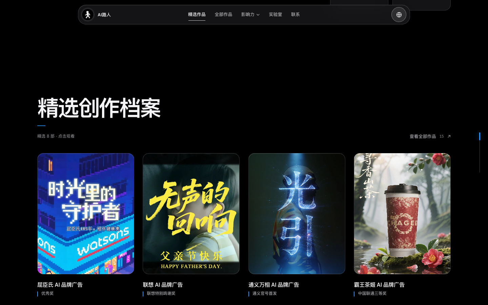
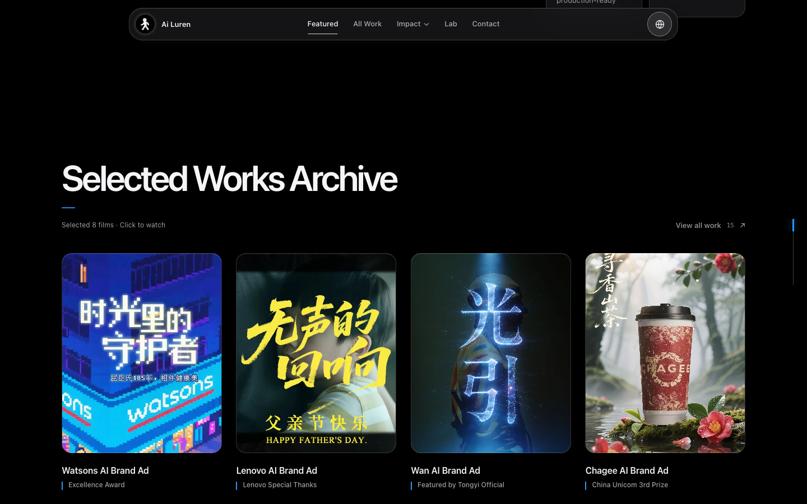
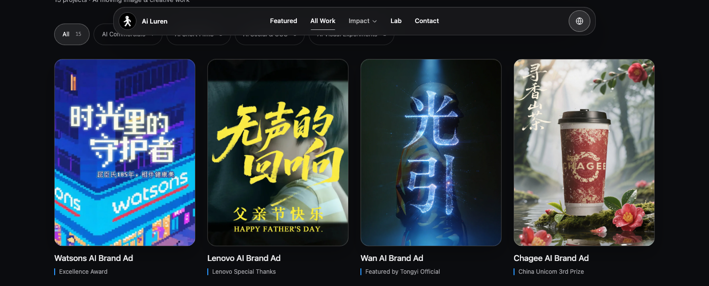
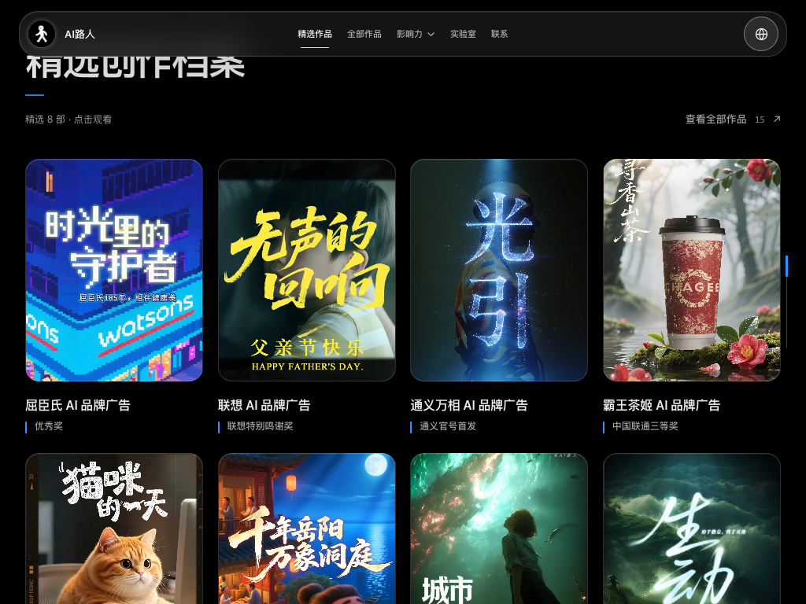
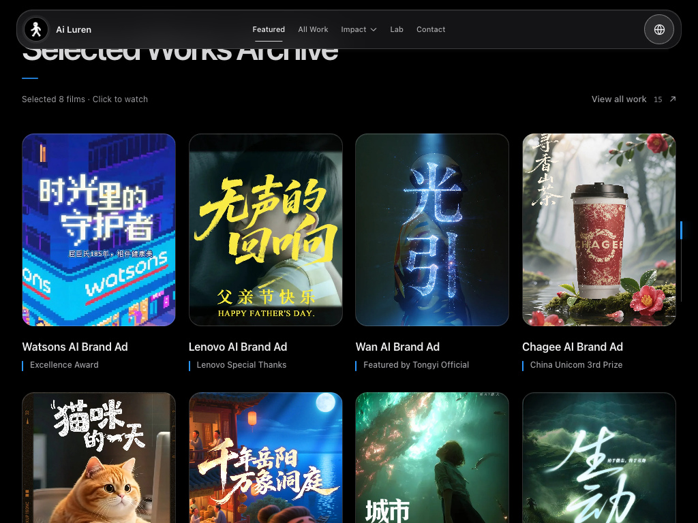
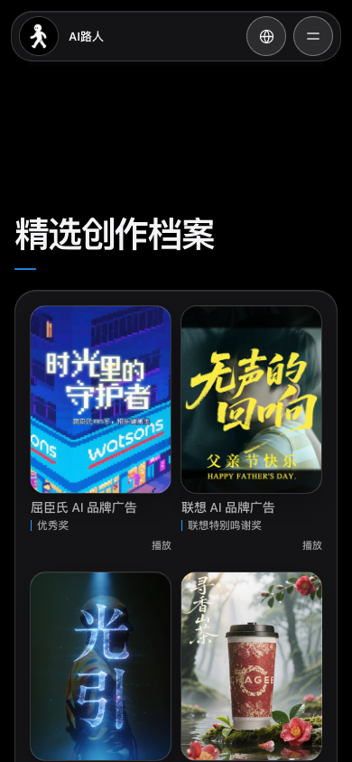
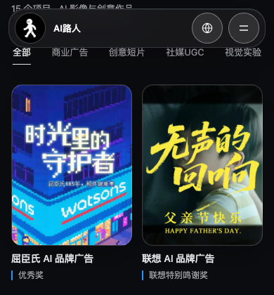
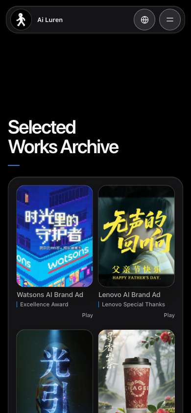

# Design System 状态核验（2026-10-16 基线快照）

> 历史审计快照：记录 2026-10-16 审计基线的 computed styles 与当时建议，不代表当前实现。后续已完成的规范化可能使表格和建议过时；当前设计真值请以 [`docs/设计规范.md`](docs/设计规范.md) 和源码为准。此文件保留用于追溯审计基线。

核验基线：`review/design-system-latest-20261016` / `aabdc6e441921a6566a6a3c59dd7ab4a5d2ea342`
方式：本地 Vite 生产构建预览 + Playwright `getComputedStyle()`，页面宽度 1440、1024、390px，中文与英文各检查。本文只记录现状与建议，不修改正式页面。

## 结论

设计系统的主干已经共享：中性玻璃材质、18/24px 圆角层级、蓝色章节短线和色彩变量均有对应 Token。真正需要在后续统一的是同类内容在不同页面的排版值，以及少数被更高优先级规则覆盖的圆角声明。首页精选 4:5 与作品库 3:4 是页面用途不同带来的合理差异，应保留。

## 首页精选作品与作品库

| 属性 | 首页精选作品 | works.html | 判断 |
|---|---|---|---|
| 封面比例，桌面 1440/1024 | 4:5 | 3:4 | 合理差异。首页精选强调视觉叙事、减少纵向占用；作品库以完整作品浏览为主，使用更高的 3:4。 |
| 封面比例，手机 390 | 3:4 | 3:4 | 一致。首页在移动端主动切换比例。 |
| 封面宽度，1440 | 285.6px | 287px | 基本一致；高度分别 357px、382.7px，差异由比例导致。 |
| 标题，1440/1024 | 16px / 22.4px，600 | 17px / 24.65px，500 | 同类卡片标题有 1px 字号、字重与行高差异。属于轻度系统不一致；两页信息密度不同可保留部分节奏差异。 |
| 标题，390 | 14.04px / 18.25px，500 | 14px / 20.3px，500 | 字号接近，作品库行高更松。应明确是否要统一行高，英文长标题需继续允许换行。 |
| 奖项/类型说明，1440 | 12px / 16.2px，500 | 12px / 19.2px，400 | 字号一致，但字重、行高不同；库页支持较长分类说明自然换行，差异有内容理由，建议统一颜色和竖线、保留行高差异。 |
| 说明竖线 | 2×15px，顶部对齐；左内缩 12px | 2×14px，顶部偏移 3px；左内缩 10px | 颜色均为 `#2997ff`，但几何和对齐点未统一。可统一 Token，按卡片信息区行高微调高度。 |
| 封面圆角，桌面 | 18px | 18px | 一致，使用共享内容圆角。 |
| 封面圆角，390 | 18px | 16px | 实际不一致。首页共享选择器以 `#projects` 高特异性覆盖移动端 16px 规则；works 页生效 16px。设计规范目前声明内容卡 18px，建议决定手机端是否也统一 18px。 |

首页比例来源：[index.html](/Users/ailuren/Desktop/个人网页作品集/index.html:940)；手机端比例规则：[apple-system.css](/Users/ailuren/Desktop/个人网页作品集/src/styles/apple-system.css:1252)。首页卡片标题：[ProjectCard.css](/Users/ailuren/Desktop/个人网页作品集/src/components/ProjectCard.css:32)。作品库比例、标题、说明：[WorksLibrary.css](/Users/ailuren/Desktop/个人网页作品集/src/components/WorksLibrary.css:29)。共享封面表面与圆角：[card-surfaces.css](/Users/ailuren/Desktop/个人网页作品集/src/styles/card-surfaces.css:60)。

## 章节标题、影响力标题与作品库标题

| 屏幕 / 语言 | 首页精选章节 | AI 获奖荣誉标题 | 作品库标题 |
|---|---:|---:|---:|
| 1440，中文 | 64px / 65.28px | 43.2px / 46.66px | 64px / 69.12px |
| 1440，英文 | 64px / 65.28px | 43.2px / 46.66px，英文标题自然为两行 | 64px / 69.12px |
| 1024，中文 | 49.15px / 50.14px | 36px / 38.88px | 49.15px / 53.08px |
| 1024，英文 | 49.15px / 50.14px | 36px / 38.88px，允许平衡换行 | 49.15px / 53.08px |
| 390，中文/英文 | 39px / 39.78px | 35.1px / 37.91px | 36px / 38.88px |

首页章节标题由 `--type-section` 控制，影响力证据标题刻意使用较小的 `--type-impact-section`，这是主标题与子章节的合理层级。works 页 H1 与首页章节标题在桌面尺寸相同，但独立写了 `clamp(36px, 4.8vw, 64px)`，没有复用 Token；手机端因此与首页差 3px，行高也采用另一套规则。建议后续把“页面 H1”和“首页章节 H2”语义及尺度写清楚，再决定是否复用同一个 Token，而不是直接让所有标题一样大。

影响力 H2 在 [ImpactEvidence.css](/Users/ailuren/Desktop/个人网页作品集/src/components/ImpactEvidence.css:22) 有基础字号和 `#recognition` Token 规则；后续 [apple-system.css](/Users/ailuren/Desktop/个人网页作品集/src/styles/apple-system.css:1765) 又定义通用影响力 H2 字号。当前 `#recognition .impact-evidence-label h2` 特异性更高，生产构建实际胜出，因此没有视觉错误；但两处值并存会增加维护和导入顺序风险，建议在后续整理为一个明确的语义规则。

章节短线方面，首页与影响力的蓝线在 1440、1024、390 都是 24×2px、圆角 2px；桌面上方间距 20px，390 为 18px，统一由 `--heading-rule-*` 管理。works 页标题没有蓝色短线（computed `::after { content: none }`）。这属于独立作品库页面标题与首页章节标题的合理差异，但当前文档没有区分“页面标题”和“章节标题”，容易被误认为漏样式。

规则来源：[apple-system.css](/Users/ailuren/Desktop/个人网页作品集/src/styles/apple-system.css:68)、[apple-system.css](/Users/ailuren/Desktop/个人网页作品集/src/styles/apple-system.css:178)、[ImpactEvidence.css](/Users/ailuren/Desktop/个人网页作品集/src/components/ImpactEvidence.css:27)、[WorksLibrary.css](/Users/ailuren/Desktop/个人网页作品集/src/components/WorksLibrary.css:18)。

## 蓝线、说明竖线、按钮和圆角

| 元素 | 生产构建实际值 | 来源 / 评估 |
|---|---|---|
| 首页、影响力横向蓝线 | 24×2px，圆角 2px；蓝色 `rgba(41,151,255,.86)`；桌面 margin-top 20px，手机 18px | 共用 `--heading-rule-width/height/gap/radius/color`，一致。 |
| 首页精选说明竖线 | 桌面 2×15px、手机 1×12px；实色 `#2997ff` | [apple-system.css](/Users/ailuren/Desktop/个人网页作品集/src/styles/apple-system.css:280)，颜色与横线接近但不是同一颜色表达；几何尺寸另写。 |
| 作品库说明竖线 | 2×14px，顶部偏移 3px；实色 `#2997ff` | [WorksLibrary.css](/Users/ailuren/Desktop/个人网页作品集/src/components/WorksLibrary.css:36)，重复表达几何和颜色，且手机仍维持 2px 宽。 |
| 首页“查看全部” | 13px 文字链接，透明背景、无边框、无圆角，44px 最小高度 | [ProjectCard.css](/Users/ailuren/Desktop/个人网页作品集/src/components/ProjectCard.css:13)，属于轻量次级链接。 |
| 作品库分类筛选 | 桌面 12px 胶囊、999px 圆角和细边框；手机 13px 文字 Tab、无胶囊背景/边框 | [WorksLibrary.css](/Users/ailuren/Desktop/个人网页作品集/src/components/WorksLibrary.css:22)，有意响应式变化，不应强行统一形态。 |
| 获奖轮播圆形箭头 | 50% 圆角，1px 低对比边框；桌面深色底，手机略亮 | 共享图标控件风格，圆形按钮与胶囊筛选用途不同，属于合理差异。 |
| 玻璃面板 / 内容媒体 / tile | 24px / 18px / 12px；控件胶囊 999px | `card-surfaces.css` 的共享几何 Token，桌面实测符合。 |
| 手机封面圆角 | 首页 18px、作品库 16px | 与共享内容圆角规范不一致；来源是特异性覆盖而不是浏览器差异。 |

作品说明的竖线没有专属语义 Token；其尺寸、顶边位置分散在首页和 WorksLibrary 规则中。另一方面 `--type-card`（[apple-system.css](/Users/ailuren/Desktop/个人网页作品集/src/styles/apple-system.css:73)）在这两套卡片标题上没有被使用，实际各自硬编码 16px 与 17px；这会造成 Token 看似定义但无法统一同类卡片。

样式入口核对：`src/App.jsx` 与 `src/works-main.jsx` 都按 `card-surfaces.css → apple-system.css → navigation.css` 引入共享样式，作品库组件再引入自己的 `WorksLibrary.css`。本次的手机 18px/16px 圆角差异不是因为生产构建漏载 CSS，而是 `#projects .comet-archive__image` 的 ID 选择器比后续 `.comet-archive-mobile-shell .comet-archive__image` 更具体，导致 13px 规则虽然在后加载仍不生效。生产预览读到的 computed value 是最终裁决依据。

## 设计缺陷与合理差异

**建议纳入后续统一的差异**

- 首页精选与作品库同类卡片标题：字号、字重和行高规则不同，尤其桌面 16px/600 对 17px/500。
- 两页说明竖线的宽度、高度、顶边偏移、左缩进各自维护；颜色也有 alpha 与实色写法差异。
- 手机两页封面圆角实测 18px 对 16px，与共享 18px 内容媒体角色不一致；首页 13px 的后置声明还被高特异性共享规则盖过，源码意图与结果不同。
- 作品库 H1 独立硬编码，而非消费已存在的章节标题 Token；导致 390px 与首页相差 3px，行高也不同。
- 影响力 H2 存在组件级基础值、组件 Token 规则和全局后置规则并存；目前实际结果正确，但维护路径不唯一。
- `--type-card` 定义存在但首页与作品库卡片标题未使用，属于未接入的重复规范入口。

**应保留的页面差异**

- 首页精选封面桌面 4:5、手机 3:4；作品库全尺寸 3:4。照片比例用于适配首页精选叙事密度与完整库浏览密度，不是要统一成同一比例。
- 首页有章节级 24px 蓝色横线，works 页面 H1 无蓝线：页面身份和层级不同，可以保留。
- 首页“查看全部”是文字链接，作品库筛选在桌面为胶囊、手机变文字 Tab；获奖箭头为圆形图标按钮。功能语义和可用空间不同，形态差异合理。
- 影响力子标题显著小于首页章节标题；英文允许比中文多行，实际边界未裁切，属于语义层级和语言长度的正常适配。
- Works 说明文字的较松行高有助于较长奖项自然换行；统一时应避免为了数值一致而损害可读性。

## 与 `docs/设计规范.md` 的差异

1. 第 20 行称页面主标题统一使用章节 Token，但 works H1 使用独立 clamp；桌面结果相同，手机实际为 36px 对 39px。文档需区分独立页面 H1 与首页章节 H2，或明确二者共用 Token。
2. 第 20 行称两级标题都保留蓝色短线；works 页面主标题没有短线。若这是预期差异，应将“章节标题”范围写清楚。
3. 第 15 行规定内容卡 18px；桌面两页实际 18px，手机 works 16px、首页 18px。文档未注明移动端例外。
4. 第 21 行规定封面下为标题和类型/奖项，但没有说明首页桌面 4:5、首页移动 3:4、works 全端 3:4 的比例契约。
5. 第 22 行写获奖画廊宽屏每屏 3 张，而生产构建当前画廊规则/审计记录显示首屏 4 张；应将获奖画廊纳入核验并决定文档还是页面需要更新。此处只指出冲突，不在本轮修正 UI。
6. 第 34 行仍写「关于我采用无卡片的编辑式正文」，但当前该内容已与开始合作整合进玻璃卡片；这是明确的文档过期项。

## Step 01—04 修改范围建议

以下仅为后续方案，不在本轮实施。

| 阶段 | 建议修改文件 | 建议范围 |
|---|---|---|
| Step 01：语义 Token 与规范 | `src/styles/apple-system.css`、`src/styles/card-surfaces.css`、`docs/设计规范.md` | 梳理页面 H1 / 章节 H2 / 影响力子标题 / 卡片标题 / 辅助说明的语义字号；明确横线与媒体说明竖线 Token；记录页面级圆角和标题装饰差异。先消除重复定义，不全局调大或调小字号。 |
| Step 02：封面与圆角契约 | `index.html`、`src/styles/apple-system.css`、`src/styles/card-surfaces.css`、`src/components/WorksLibrary.css` | 保留首页桌面 4:5、手机 3:4、作品库 3:4；明确手机内容媒体统一 18px，或正式记录 16px 页面变体。清理被 `#projects` 高特异性覆盖的移动圆角声明，保证生产构建与源码意图一致。 |
| Step 03：卡片信息节奏 | `src/components/ProjectCard.css`、`src/components/WorksLibrary.css`、`src/styles/apple-system.css` | 统一标题颜色层级、字号基准、移动端行高、说明文字颜色及蓝色竖线起点；允许库页长奖项行高略松。让 `--type-card` 真正被消费或删去/重命名未使用 Token（需单独确认后实施）。 |
| Step 04：页面差异与回归约束 | `docs/设计规范.md`、必要时 `scripts/check-i18n.mjs` | 写清作品页标题无短线、首页/作品库筛选控件差异、双语换行边界和 4:5/3:4 规则；为生产预览增加计算样式与边界检查，覆盖 1440/1024/390、zh/en。回归检查桌面/手机截图、作品卡和影响力标题。 |

## 生产构建计算样式截图

以下为生产预览的真实浏览器截图，不是 mock。首页与作品库依次对照；中文和英文均已采集。

### 1440px 桌面

| 首页精选 | 全部作品 |
|---|---|
|  |  |
|  |  |

### 1024px 桌面 / 小型笔记本

| 首页精选 | 全部作品 |
|---|---|
|  |  |
|  |  |

### 390px 手机

| 首页精选 | 全部作品 |
|---|---|
|  |  |
|  |  |

### AI 影响力标题

- [1440 中文影响力局部](design-system-current-audit-figures/home-impact-zh.png)
- [1440 英文影响力局部](design-system-current-audit-figures/home-impact-en.png)

Playwright 原始计算样式记录位于 `computed-styles.json`，随截图一同保存在上述目录；包含 1440/1024/390 × 中文/英文 × 首页/作品库的 12 组数据。

## 核验边界

- 已执行 `npm run build`，生产构建成功；Vite 输出了既有 inline GSAP 脚本无法 bundle 的提示，但构建完成。
- 使用本地产物的 Vite Preview 读取样式及截图，测试范围为页面排版与资源渲染，不等于完整播放器交互回归。
- 没有修改 UI、CSS、翻译或作品数据。
